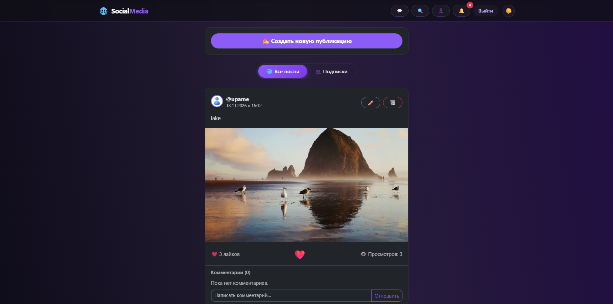
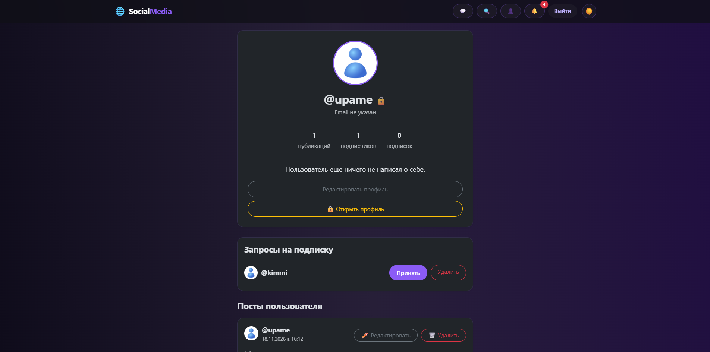
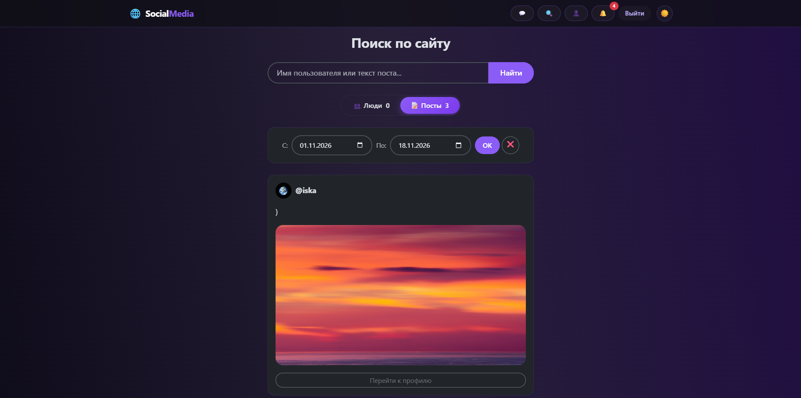
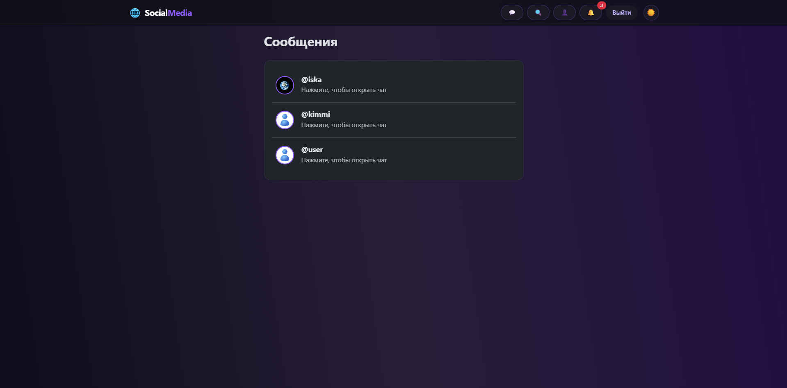
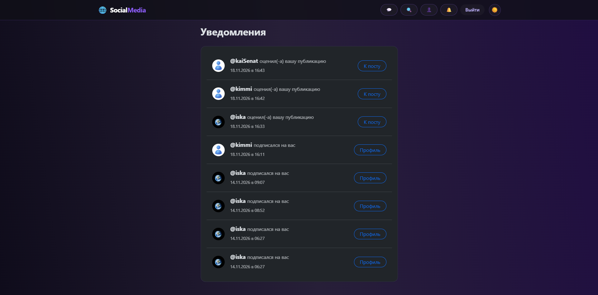

# Social-Media

Веб-платформа социальной сети на Django с поддержкой публикаций, мгновенных лайков без перезагрузки страниц, личных чатов, гибких настроек приватности и расширенного поиска.

🔗 **Живое демо:** [Посмотреть сайт](https://social.pythonanywhere.com/)

## ✨ Что умеет проект

- **Умный поиск:** раздельный поиск по пользователям и постам с возможностью фильтрации публикаций по диапазону дат.
- **AJAX-лайки и просмотры:** сердечки ставятся мгновенно без перезагрузки, а каждый лайк автоматически фиксирует просмотр поста.
- **Приватность и подписки:** закрытые профили, система заявок на подписку (контент закрытого аккаунта скрыт до одобрения заявки), черный список и блокировки.
- **Публикации и общение:** создание постов с фото, комментарии, живые обсуждения и личные сообщения между пользователями.
- **Уведомления:** система оповещений о новых лайках, комментариях, заявках в друзья и принятых подписках.

## 📸 Интерфейс приложения

### Лента публикаций


### Профиль пользователя


### Поиск пользователей и постов


### Личные чаты


### Система уведомлений


## 🛠 Технологии

* **Backend:** Python 3, Django 5
* **Frontend:** HTML5, CSS3, Bootstrap 5, JavaScript (Fetch API / AJAX)
* **База данных:** SQLite
* **Хостинг:** PythonAnywhere

## 🚀 Как запустить проект локально

1. Клонируйте репозиторий:
```bash
git clone https://github.com/15kander/social-media.git
cd social-media
```

2. Создайте и активируйте виртуальное окружение:
```bash
python -m venv venv
venv\Scripts\activate
```

3. Установите зависимости и запустите сервер:
```bash
pip install -r requirements.txt
python manage.py migrate
python manage.py runserver
```

## 📂 Структура проекта

```text
├── config/             # Настройки Django (settings.py, urls.py)
├── core/               # Основное приложение (models.py, views.py)
├── templates/          # HTML-шаблоны страниц
├── static/             # CSS и JS файлы
├── manage.py
└── requirements.txt
```